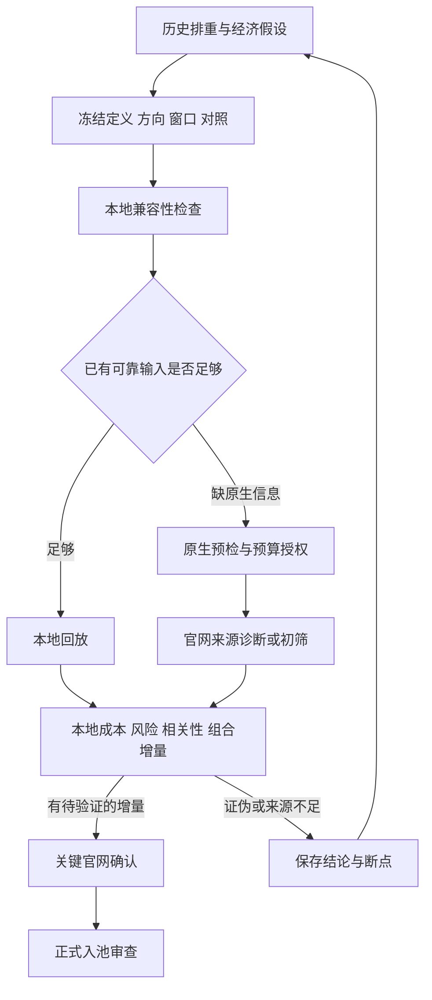

# QUANTAXIS · Panda Alpha 因子研究

这是基于 [QUANTAXIS](https://github.com/yutiansut/QUANTAXIS) 构建的 PandaAI 因子研究 Fork。**master 是当前工作流的默认分支**，包含统一数据渠道、假设与反思、因子去重、成本后回放、收益归因、组合增量审查和官网算力管理。

目标是寻找可解释、可复现、扣除交易损耗后仍有价值的因子。净收益、稳定性、回撤、规模、行业暴露、独立信息和实际组合增量共同决定质量，官网积分作为验证的一部分。

研究层位于 [panda_alpha/](panda_alpha/)，版本为0.1.0，推荐Python3.11。上游交易、Web和Rust服务可独立部署；使用研究层不要求先安装整套上游依赖。原版说明保存在 [README_UPSTREAM.md](README_UPSTREAM.md)。

## 当前工作流

1. **提出机制并排重。** 读取保留的研究结论、失败原因及人工淘汰约束，冻结定义、方向、窗口、来源范围和共同对照。
2. **简短离线检查。** 核查字段、算子、索引、窗口预热、缺失值和输出分组；Python官网候选执行实际原生接口预检。
3. **按信息缺口选择本地或官网。** 已有可靠输入就先本地回放；缺官网原生动态输入时做有界来源诊断或初筛，不要求先重建完整本地财务资料库。
4. **本地复用结果。** 计算30/50bp成本、价格损益与费用、换手、集中度、信号与收益相关性，以及真实信号组合增量。
5. **对幸存候选做关键官网确认。** 明确这次运行能新增什么信息，复用完全相同口径的既有对照，按共享预算串行派发与结算。
6. **独立进行正式入池审查。** 验证来源时点、交易约束、稳定性及实际池增量；研究结果不会自动新增、删除或替换正式池。



来源待补、执行故障、经济不通过和正式入池分别记录。缺少数据不会耗尽经济调查次数；已看过的历史窗口不能重新称为独立样本外。参数、窗口或符号变动必须有研究理由，避免重复扫描同一机制。

## 官网算力门槛与入池规则

默认配置见 [research-workflow.v1.json](config/research-workflow.v1.json)：

- **一轮跨方向共用60点，最多20次官网尝试，任一先到就停止新增派发。** 日期、方向、候选名称、窗口或资金批次变化不重置本轮额度。
- **每累计20点做一次免费本地证据复盘。** 选择继续、转向或仅做本地研究；复盘可由研究流程在授权范围内完成，不是逐次人工审批。
- **单经济机制初探最多2次，全程最多4次。** 必要对照计入初探，后续调用须为有证据的关键确认；数值参数变体同时按代码族归组。
- 实扣与未结算预留共同占用预算；失败尝试及失败扣费均计入。重复请求查询原Run，模糊派发不自动重发。
- 本地预算政策不授予收费权限。赠送优先，充值按具体批次确认；已批准的总额和有效期继续约束运行。

这些是本地派发门槛，**不是平台单次扣费硬上限**。实际结算超出估算或无法归因时，停止新派发并核查原Run。

正式新增或替换单因子的底线为：**单边30bp成本后、多头持仓净日收益的年化Sharpe ≥ 0.5**。旧2/2.5门槛已退休。该底线不用于阻止有信息价值的官网探索，通过它也不替代来源、风险、独立性及完整池增量审查。详见[入池门槛](docs/pool_admission.md)及[官网研究预算](docs/official_compute.md)。

## 在原工作基础上新增的能力

### 数据与披露时点

[AxisProvider](panda_alpha/data.py) 与 [sources.py](panda_alpha/sources.py) 统一QUANTAXIS兼容MongoDB的读取、渠道职责、覆盖检查、同步断点和输入导出。

本机研究以经过来源契约验收的StockDB日线为主；BaoStock保留已取得的资料和对照，AKShare/TDX用于明确补缺或独立核查。不同价格来源隔离存储，不自动混源。**AXIS承担数据组织与查询，数据供应商可用性仍需单独解决。**

财报接口区分报告期、公告日、首次可用日、合并/母公司报表、单位和修订版本。空白、横杠及缺字段不填零；当前重述值不能回填公告前历史。金额拆行、粘连与续页问题通过原文、哈希及PDF版面证据修复。资料范围验收不等同于完整全市场历史可用性认证。

相关说明：[统一渠道](docs/data_sources.md)、[财报解析](docs/statement_parsing.md)。

### 研究记忆、去重与反思

[evolution.py](panda_alpha/evolution.py) 记录经济假设、父候选、反思和证伪方案；[diversity.py](panda_alpha/diversity.py) 检查结构/参数族重复，以及同股票同日期的实际因子值相关性。

[registry.py](panda_alpha/registry.py) 用同一SQLite事件账本登记唯一经济实验、来源修复、执行修复和淘汰。不同费用档和软件修复不重复增加实验分母，累计值不当作历史基数重新相加。人工淘汰不能通过改名或后代候选绕过；固定经济失败只约束对应定义和研究上下文。

LLM请求默认关闭。启用模型须显式配置后端与环境变量，生成结果仍是待验证假设。

### 回放、归因与组合

[study.py](panda_alpha/study.py)、[execution.py](panda_alpha/execution.py) 和 [attribution.py](panda_alpha/attribution.py) 共同记录现金、持仓数量、交易费用、价格损益与净值；[portfolio.py](panda_alpha/portfolio.py) 和 [admission.py](panda_alpha/admission.py) 审查组合增量与正式准入。

多因子先合成真实信号再生成持仓，不平均两个回测的收益。比较使用共同形成股票、持有日期和成本口径。默认保留精简结果，逐证券执行明细按需启用。

### 官网执行与恢复

[native_preflight.py](panda_alpha/native_preflight.py) 检查实际计算兼容性；[platform.py](panda_alpha/platform.py) 与 [research_budget.py](panda_alpha/research_budget.py) 保存预算预留、Factor/Run ID、阶段复盘及结算。

官网任务分为native_screen、source_diagnostic和key_confirmation。候选必须声明问题、通过/失败后的决定、稳定机制及具体官网信息缺口；关键确认绑定已有结果文件。字段目录存在、兼容性预检通过、实际输入期间正确和生产更新可用分别验证。

## 快速开始

克隆master包含源码、公开配置及必要小型证据。行情库、个人配置、账号、完整原件与私有实验账本需要自行提供。

```powershell
git clone --branch master https://github.com/Yanxxzz/QUANTAXIS.git
cd QUANTAXIS
py -3.11 -m venv .venv
.\.venv\Scripts\python.exe -m pip install -r requirements-panda-alpha.txt

# 已有个人配置时保留原文件
Copy-Item config\panda-alpha.example.json config\panda-alpha.local.json
$Python = ".\.venv\Scripts\python.exe"
$Config = "config/panda-alpha.local.json"
& $Python -m panda_alpha --help
```

按实际数据修改MongoDB、渠道、允许窗口、封存窗口、历史记忆和池面板。官网账号凭据由用户CLI配置管理，不写入仓库。Linux/macOS使用Python3.11及.venv/bin/python执行同一研究入口。

无需访问账号的预算与研究登记检查：

```powershell
& $Python -m panda_alpha --config $Config compute-status
& $Python -m panda_alpha --config $Config registry status
```

离线生成候选：

```powershell
& $Python -m panda_alpha --config $Config plan `
  --count 4 --state research_runs/evolution_state.json `
  --output research_runs/generation01.json
```

生成计划不表示字段、方向、独立性或收益已合格。已有数据时可用evaluate做本地两费档回放，再用evolve读反馈推进；使用官网前补齐候选决策字段、原生预检及具体预算授权。

官网计划预览与原Run恢复：

```powershell
& $Python -m panda_alpha --config $Config schedule `
  --candidates research_runs/generation01.json

$Fingerprint = "填写已保存的真实指纹"
& $Python -m panda_alpha --config $Config resume `
  --fingerprint $Fingerprint --ledger research_runs/experiments.sqlite3 `
  --output research_runs/official_results
```

schedule免费读取余额；compute-status与compute-review完全离线。dispatch --execute才启动已授权的新官网运行，轮询超时不等于服务端任务取消。完整部署、本地评估、候选字段、阶段复盘与准入命令见[工作流](docs/panda_alpha_workflow.md)、[研究说明](RESEARCH.md)和[官网预算](docs/official_compute.md)。

## 结果、存储与验证

研究结论和失败原因按单元保留，收益报告明确来源范围、费用、成交代理和已知限制。运行成功与因子有效分别记录；局部样本或未计成本的官网分组统计不会被当作已通过正式入池。

[research_storage.md](docs/research_storage.md)规定共享数据、保留来源网址/哈希、公式、精简指标、淘汰原因和恢复位置。公开PDF缓存、重复快照和不必要的逐股逐日输出可按审核清单释放；独有输入、原始提取文本和有效研究证据保留。research_runs默认忽略，少量明确审核的协议、代码及结果会随提交公开。

近期研究记录：[WC03与F141反思](docs/wc03-night-continuation-20261011.md)、[现金投入与研发验证](docs/cash-investment-research-20261012.md)、[两连板急跌策略与事件因子](docs/limit-event-factor-20261014.md)、[三种指定止损对照](docs/limit-stoploss-20261014.md)。实时实验累计来自research_trials.sqlite3，主页不维护会过时的手写累计值。

```powershell
& $Python -B scripts/verify_public_research.py
& $Python -m pytest tests -q
```

GitHub Actions对研究层执行公开源码与合成数据检查，以及离线回归。测试不调用真实官网回测，也不替代外部来源、完整历史股票池、修订链、竞价或容量验收。独立研究镜像说明见[docker/panda-alpha](docker/panda-alpha/README.md)。

日常提交保留Panda Alpha harness、Python application、Python package和研究镜像构建检查。上游遗留的三个Docker发布任务、两个QABook编译发布任务和mdbook Pages部署均改为手动触发，避免每次提交研究代码时反复执行无关发布。旧任务的镜像源、LaTeX依赖与发布权限需在手动使用前单独配置；当前研究镜像发布仍通过[docker-publish.yml](.github/workflows/docker-publish.yml)的手动publish选项启用。

## 上游与许可

- [QUANTAXIS](https://github.com/yutiansut/QUANTAXIS)：数据结构、来源接口、复权及量化框架；原说明与版权保留。
- [QuantaAlpha](https://github.com/QuantaAlpha/QuantaAlpha)：多样化规划、轨迹进化与反思的方法参考。
- 本仓库许可与原作者版权见[LICENSE](LICENSE)。
