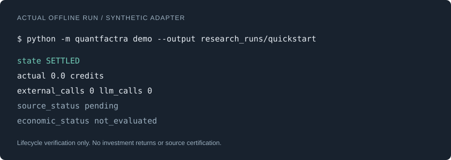
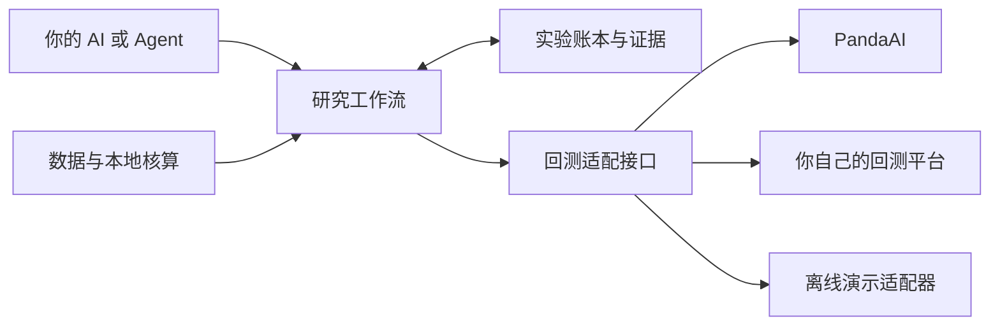

<p align="center"></p>

<p align="center">
  <a href="https://github.com/Yanxxzz/quantfactra/actions/workflows/panda-alpha.yml"></a>
  <a href="LICENSE"></a>
  <a href="setup.py"></a>
</p>

<p align="center"><b>面向 AI 开发者的量化因子研究工作流</b><br>让 Agent 提出假设，让程序保留定义、回测、费用与证据。</p>

<p align="center"><a href="README_EN.md">English</a> · <a href="#先跑一个离线演示">快速开始</a> · <a href="docs/architecture.md">架构</a> · <a href="docs/backends.md">接入回测平台</a> · <a href="docs/ai-integration.md">接入 AI</a> · <a href="CONTRIBUTING.md">参与开发</a></p>

## QuantFactra 做什么？

QuantFactra 帮你搭建和修改量化研究 Agent：从假设、因子实现、本地回放到外部回测与独立复核，持续记录“试了什么、为什么继续或停止、还缺什么证据”。

- **研究可追踪**：冻结定义与比较规则，保留成功、失败、待核结果和数据范围。
- **平台可替换**：PandaAI 是内置适配器；自己的回测平台通过 Python 接口接入，使用中立状态、报告和计费回执。
- **AI 可组合**：使用现有 OpenAI 兼容规划接口，或让自己的 Agent 实现任务消息协议；研究账本和执行规则继续由程序维护。

适合修改研究流程、实现新回测适配器、接入模型或开发工具的开发者。真实行情与回测源仍需自行提供；数据入口当前采用 QUANTAXIS 兼容结构。软件运行成功、来源验证、经济有效性和正式入池分别判断。

## 先跑一个离线演示

支持 Python 3.11 / 3.12。建议在虚拟环境中安装；完整说明见[快速开始](docs/quickstart.md)。

```bash
git clone https://github.com/Yanxxzz/quantfactra.git
cd quantfactra
python -m pip install -e .
python -m quantfactra demo --output research_runs/quickstart
```

打开 `research_runs/quickstart/report.html`。这次运行会生成独立实验账本、配置、预检、报告和零费用回执，实际走完 **创建 → 启动 → 原任务恢复 → 结算**。

<p align="center"></p>

演示只使用本地合成适配器，不访问模型、行情库或回测官网，也不生成投资收益。重复运行请换一个新的输出目录，以保留原件。

## 如何理解整个项目？



**Agent 负责提案与判断；程序负责固定检查、执行、恢复和记账。** 平台适配器处理平台自己的语言、任务状态、计费和报告，不能替代研究来源审查。

## 从哪里开始修改？

1. **换回测平台**：读[适配指南](docs/backends.md)，参考[可运行适配器](quantfactra/adapters/demo.py)，实现自己的 `module:factory`。
2. **接入自己的 AI**：读[AI 接入指南](docs/ai-integration.md)，选择规划接口或任务消息协议。
3. **改研究流程**：读[架构与维护地图](docs/architecture.md)，再定位工作流、本地核算或证据模块。
4. **给项目贡献代码**：读[贡献指南](CONTRIBUTING.md)，从文档、适配器示例或接口测试开始。

```bash
python -m quantfactra --help
python -m quantfactra research --help
python -m quantfactra team --help
python -m quantfactra team host-demo --output research_runs/team_demo
```

## 支持范围

- **PandaAI**：已有真实运行与恢复链，保留原钱包、原生预检和报告接口。当前维护不自动启动研究或修改正式池。
- **QuantFactra v1 自定义适配器**：接口、原任务恢复、独立计费单位、免费/预付费回执和中立报告已具备；新官网必须完成自己的适配与验证。
- **离线适配器**：用于上手和接口演练，可断网运行。
- **本地核算**：复用 QUANTAXIS 数据结构与已有持仓、现金、费用核算，不另造一套回测器。

真实财务来源/PIT、全市场覆盖、容量或收益改进不能由合成测试认证。新模型或新平台也不会继承旧平台的来源资格。

## 开发与兼容

```bash
python -B scripts/verify_public_research.py
python -m pytest tests -q
```

公开名称、安装包和主命令统一为 **QuantFactra / `quantfactra`**。原 `panda_alpha`、`panda-alpha` 和 `quant-research` 入口为旧脚本保留；上游源码、历史结果、实验身份和账本不做批量改名或清零。新配置示例在 [config/quantfactra.example.json](config/quantfactra.example.json)，已有研究应继续使用原配置。

## 参与与路线

欢迎提交复现问题、文档改进和平台适配器。请用[Issue 模板](https://github.com/Yanxxzz/quantfactra/issues/new/choose)说明环境、最小复现和预期结果。[项目计划](docs/project-plan.md)列出当前优先级；[开源项目对照](docs/open-source-review.md)解释我们在上手、展示、文档与扩展方式上要学习什么。

如果这个项目帮助你搭建了研究 Agent，欢迎 star，或分享一个可复现的使用案例。

## 上游与许可

基于 [QUANTAXIS](https://github.com/yutiansut/QUANTAXIS) 的数据、计算和回测能力；[上游原始说明](README_UPSTREAM.md)与版权保留。方法参考与历史研究见 [RESEARCH.md](RESEARCH.md)。许可见 [LICENSE](LICENSE)。
