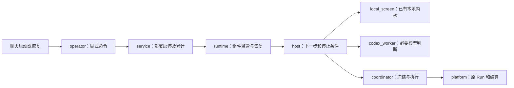

# 架构与维护地图

日常入口是 `python -m panda_alpha.team`，人通过 Codex 聊天授权。目标是以有限模型和官网资源找到有积分潜力且可靠的因子。默认 lean：一个主研究员、本地程序先筛、必要独立审查；旧四角色协议为兼容原会话和明确选择的复杂研究保留。

## 先理解一条运行链

`operator` 检查现场、保存启动回执，并在冻结 checkout 中执行 `python -m panda_alpha.team.service`。`service` 保留部署启动次数、启停开关和绑定；`runtime` 管理组件、模型超时和进程接管。三者处理不同生命周期，合并会把恢复边界混进聊天命令。

`host` 不复制回测或余额。`local_screen` 调用已有 `study.prepare_study/evaluate_study`；`coordinator` 通过原执行器派发。`codex_worker` 只接收相关工作包，工具受限、尝试和原会话持久化。确定性计划、固定检查和结案不额外调用模型。

## 状态为何保留这些部分

1. **实验账本**：真实指纹、预留、Factor/Run ID、状态和结算。任务板、消息、有限宿主工作与结案意图在同一 SQLite 文件，各表复用一个预算权威。
2. **科学登记**：唯一经济定义、来源／执行／经济判断、失败与待核。实现修复不冒充新机制，费用路径不增加独立假说数。
3. **不可变原件**：输入、代码、协议、原报告、模型回复、回执及 SHA256。JSON 包和热记忆是阅读与恢复视图，不独立裁决状态。

跨两库结案采用“保存意图 → 幂等科学事实 → 关闭任务”。中断测试覆盖边界，不强行搬到一套新数据库。固定待核编号和证据绑定替代关系由 `qualifications.py` 与原事件共同维护。

`team/budget.py` 分配已获准范围，`research_budget.py` 检查共享研究轮，`platform.py` 原子预留及结算；它们不是三份余额。配置示例与旧研究模板都不构成当前授权。

## 按问题找文件

- **下一步为何等待或停止**：`team/host.py`、`team/local_screen.py`；先查 `host-status.json` 和原 session 工作，不靠模型重述现场。
- **启动、断线、进程恢复**：`team/operator.py`、`service.py`、`runtime.py`、`runtime_io.py`、`codex_worker.py`；核验进程出生身份，不能只看 PID。
- **请求或报告不合法**：`team/contracts.py`、`team/evidence.py`、`native_preflight.py`；交付、来源和经济分别判断。
- **新来源和同任务重审**：`team/sources.py`、`public_docs.py`、`data_sources.py`；显式有限取数，完成查询断点复用，缺口不填零。
- **本地收益或成本不一致**：`study.py`、`execution.py`、`attribution.py`、`evaluation.py`；从行情、独立日历及持仓账本复核同样本结果。
- **原 Run、余额或未结算**：`platform.py`、`research_budget.py`；未知响应先对账，只恢复原 Run。
- **历史约束或资格消失**：`registry.py`、`memory.py`、`qualifications.py`、`team/conclusions.py`；先查原事件，不靠清空或重登记修复。
- **正式池判断**：`quality.py`、`pool_admission.py`、`pool_scoring.py`；探索价值、成本后表现、正式池增量分别报告。

## 每类目录的取舍

`panda_alpha/team/` 是流程核心。根包中的取数、核算、预算和科学记录为公共内核；经营科目、涨停事件、融资、现金和市场行为模块是研究组件。它们有现存调用、测试或历史协议，不因默认 lean 未导入就判为死代码。候选先放运行目录，有明确复用需求再提取公共模块。

`scripts/` 包含数据运维、验证、旧 CLI 包装及绑定历史协议的运行器。`Invoke-PandaResearch.ps1` 保留环境恢复和退出码处理，不是第二个无人值守宿主。`research_io.py` 已收敛多份脚本 I/O，不再加一套脚本框架。

`config/` 是模板和版本化政策；旧 v1/v2 用来解释旧判断，不删除或改成 v3。`.codex/agents/` 保留兼容提示，默认并不启动四个角色。`tests/` 验证软件，不证明因子或多 agent 更优。

`docs/`、`RESEARCH.md`、已有跟踪的 `research_runs/` 与 `research_bootstrap/` 保存说明、协议和冷启动材料。私有一次性程序留在忽略提交的运行目录。不能因为“Git 有历史”就无差别删除原件；旧研究复现使用冻结版本、代码哈希和原输入，不追改回执以接受新代码。

`QUANTAXIS/`、`qapro-rs/`、`docker/`、`doc/`、`qabook/`、`examples/` 是上游兼容层和可选材料。研究层无需整套服务，但构建、导入和用户策略仍依赖其中一部分，不做无证据的搬迁或重写。版权和许可保留。

## 本次实际删除和合并

2026-10-21 核对维护调用链及直接引用后：

- 删除旧计划任务安装器 `scripts/team-service.ps1`、登录自启说明及仅服务该适配器的两项测试。本机旧任务已卸载；聊天控制及真实子进程恢复回归保留。
- 删除10行 `scripts/team_service.py` bootstrap。operator 已固定 `cwd=repo`，改用包模块入口，原 `--launch` 握手及解释器保持。删除 service 重复的 `--enable/--stop` 命令分支，程序接口仍供 operator 调用。
- 删除 `pythonapp.yml`，其安装后 DataFrame 冒烟合入包装检查。完整回归从每事件5组减为3组，保留 Linux 3.11／3.12 和 Windows 3.11。包装仍检查两版 Python 的 sdist、wheel、元数据和 checkout 外导入。
- Docker 按相关路径触发；上游书籍与发布本就手动，保持。README 改为安装、研究、控制、维护的使用顺序，过程结果引用研究报告。

研究分支由 PR 事件检查，主线／develop 及版本标签仍检查 push；同一研究分支不再同时触发 push 和 PR 两套相同行为回归。包装检查沿用同一触发方式。

随后真实提案暴露了另一处阻点：模型未收到完整的嵌套请求结构，连续用新调用发现 `candidate`、`mechanism_id` 和 `candidate_id`。现已在 worker 的动作契约中明确顶层字段、嵌套 candidate、机器标识及执行字段与诊断字段的区别；host 在科学判断前先调用原请求校验器，返回可理解的契约错误。原失败和4次已发生尝试保留，不算成4个新机制；仅结构修正复用原意见，不伪造新模型判断。

真实结果审查又暴露202,533字节工作包超过原180KB上限。`context_codec`现在也对重复的小型原件绑定使用精确引用；长指针比原值更大时仍内联。原工作包、证据、资格ID／修订／状态均不改，完整解码一致，实际提示178,432字节后完成原工作。增加两项针对该缺口的回归，没有提高提示上限或删去异议。

后续H20确认被现有封存／暖机检查正确阻断；一次性诊断调用它太晚，部分信号和标签已曝光。保留失败，停止确认；准备顺序改为先核对实际暖机范围，再取数和生成标签。既有公共检查器无需重写，也不以换窗或解除封存解决方案冲突。

没有证据要求重写 `quality.py`、另建回测器或合并账本：代码已区分成本受限、机制反证、来源不足和池增量。主要问题是入口及旧说明混杂、CI 重复，以及把某次研究门槛误读成所有探索的全局门槛。

## 修改与验收顺序

先定位原件和实际调用者，再做最小修改。恢复改动跑 `test_team_service/operator/runtime/online_control`；覆盖暂停恢复、强杀接管原尝试、磁盘恢复、截止／启动上限、模糊启动阻断、原 Run 恢复及来源／PIT／grant 阻断。合成测试不能写成真实研究成功。

交付前运行 `python -B scripts/verify_public_research.py`、`python -m pytest tests -q`，以及 checkout 外安装冒烟。CI 和审查次数不替代研究证据。清理遵守[证据存储](research_storage.md)，保留用户未提交策略、原失败、账本和冻结契约。
