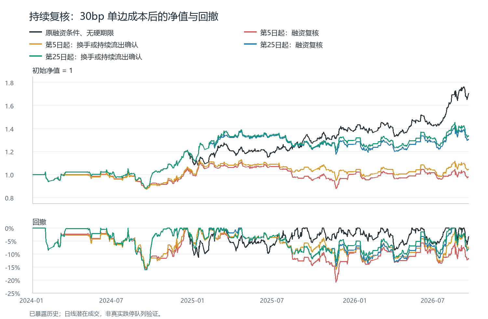

# 融资条件退出后的持续复核：完整回测

**结论：本样本中的长期占槽明显减少，但没有同时保留收益、降低最大回撤。四个新规则均不替换原基准，也未形成入池候选。** 第25日起加入换手或连续流出确认的版本，在新规则中收益保留较多，但30bp总收益仍从70.40%降至33.78%，最大回撤仍为16.12%；50bp收益从60.11%降至24.19%。这是规则的实际代价，不能以持仓变短包装成全面优化。

基准是已完成的“融资条件退出、无硬期限”版本。原入场、10%止盈、首次8%亏损融资复核、第20日融资复核、五仓及费用规则均保留。本轮只增加持续复核，不重跑旧基准；2024-01-02至2026-09-18，共659个参考交易日，1444个固定候选机会。历史已多次暴露，以下均为探索回测。

## 固定规则和时钟

- 融资复核：每5个参考交易日，在开盘前使用上一日经济收盘收益；持仓亏损且近5日融资买入额减偿还额合计为负，排队退出。
- 确认复核：相同时钟，要求融资净流出，同时满足“近5日平均换手率低于近20日平均”，或连续两次复核均为融资净流出。连续两次所用5日报告区间不重叠。未知融资中断连续计数，不填0；换手未知不能触发降温分支，但完整融资连续流出分支仍有效。
- 首轮从买入后第5日起复核。全部结果收齐后，为区分提前干预和长期延续，另登记唯一时钟对照：前20日完全沿用基准，第25日起按原5日间隔持续复核，连续计数也从25日开始。没有继续扫描起点、间隔或阈值。后两条属于事后提出的消融。
- 两类规则均无最长持仓上限。原首次触价、第20日规则继续有效；新增开盘前退出优先于当天新触发的盘中止损。已确认卖出若遇停牌、跌停或容量阻挡，会持续等待合法成交，不因随后融资改善而取消。
- 融资及换手截止复核前两日，采用完整参考日窗口；5日融资净流量比例为Σ(买入−偿还)/Σ(买入＋偿还)，换手为均值5/均值20。两日滞后不等于认证真实公告到达时间或修订版本。

## 同费用账户结果

|版本|30bp总收益|30bp日年化Sharpe|30bp最大回撤|50bp总收益|50bp最大回撤|
|---|---:|---:|---:|---:|---:|
|原融资条件、无硬期限|70.40%|1.205|16.12%|60.11%|16.37%|
|第5日起：融资复核|-1.95%|0.029|20.91%|-9.49%|22.08%|
|第5日起：换手或持续流出确认|4.77%|0.191|16.18%|-3.61%|17.26%|
|第25日起：融资复核|30.72%|0.676|16.12%|20.48%|16.37%|
|第25日起：换手或持续流出确认|33.78%|0.722|16.12%|24.19%|16.37%|

30/50bp为单边费用，已计入账户净值；总收益不是年化收益。

## 占槽与收益代价

|版本|满五仓日数|持仓≥60日累计槽位日|期末最长持仓年龄|平均资金暴露|提前亏损卖出的基准最终赢家|新增交易已平净损益|
|---|---:|---:|---:|---:|---:|---:|
|原融资条件、无硬期限|43|600|454日|39.62%|—|0.00元|
|第5日起：融资复核|1|0|25日|18.63%|16|-3,411.28元|
|第5日起：换手或持续流出确认|1|0|25日|20.92%|13|-3,321.27元|
|第25日起：融资复核|3|0|25日|29.28%|7|1,288.30元|
|第25日起：换手或持续流出确认|9|0|25日|30.15%|6|1,251.43元|

槽位日是每日各持仓年龄的累计计数，例如一只超过60日的股票再占用10日计10；不是成交次数。期末年龄受研究终点截断。清空本样本老仓不证明未来无法再套牢，因为所有版本均无硬期限。提前亏损卖出的赢家只作事后归因，不参与卖出信号。

**第5日起：融资复核**：基准中最终占用454日的002285，本规则退出日为2024-11-29，持仓年龄15日。相对基准的期末净值差-72,352.53元，其中共同入场已平损益差-75,375.14元、新入场已平损益-3,411.28元、期末浮动损益差6,433.90元。手续费差742.51元已含在这些净损益内，不能再重复扣除。仓位金额及复利会变化，这不是固定数量下的纯退出因果分解。

相对基准保留收益-2.8%，回撤相对降低-29.7%；配对月块bootstrap的年化日均收益差95%区间[-41.16%,-2.86%]。这是算术年化均值差，非CAGR差；未校正多次研究或选择偏差。

**第5日起：换手或持续流出确认**：基准中最终占用454日的002285，本规则退出日为2024-11-29，持仓年龄15日。相对基准的期末净值差-65,636.41元，其中共同入场已平损益差-68,464.37元、新入场已平损益-3,321.27元、期末浮动损益差6,149.23元。手续费差626.64元已含在这些净损益内，不能再重复扣除。仓位金额及复利会变化，这不是固定数量下的纯退出因果分解。

相对基准保留收益6.8%，回撤相对降低-0.3%；配对月块bootstrap的年化日均收益差95%区间[-35.33%,-3.32%]。这是算术年化均值差，非CAGR差；未校正多次研究或选择偏差。

**第25日起：融资复核**：基准中最终占用454日的002285，本规则退出日为2024-12-20，持仓年龄30日。相对基准的期末净值差-39,685.54元，其中共同入场已平损益差-43,122.92元、新入场已平损益1,288.30元、期末浮动损益差2,149.09元。手续费差2,239.95元已含在这些净损益内，不能再重复扣除。仓位金额及复利会变化，这不是固定数量下的纯退出因果分解。

相对基准保留收益43.6%，回撤相对降低0.0%；配对月块bootstrap的年化日均收益差95%区间[-23.23%,3.14%]。这是算术年化均值差，非CAGR差；未校正多次研究或选择偏差。

**第25日起：换手或持续流出确认**：基准中最终占用454日的002285，本规则退出日为2024-12-20，持仓年龄30日。相对基准的期末净值差-36,628.01元，其中共同入场已平损益差-39,767.22元、新入场已平损益1,251.43元、期末浮动损益差1,887.78元。手续费差2,383.61元已含在这些净损益内，不能再重复扣除。仓位金额及复利会变化，这不是固定数量下的纯退出因果分解。

相对基准保留收益48.0%，回撤相对降低0.0%；配对月块bootstrap的年化日均收益差95%区间[-21.73%,3.68%]。这是算术年化均值差，非CAGR差；未校正多次研究或选择偏差。

## 研究结论与边界

预先使用“保留基准至少80%收益、回撤相对降低至少20%，并减少长期占槽”作为本轮研究参照，两档费用都检查；它不是替代正式因子入池标准。所有四条持续复核规则的完整结果均保留，不选择途中最优日期或另改阈值。是否改善以表中完整结果为准。

**最大回撤为何没有随老仓清除而下降：** 基准的最大回撤发生在2024-08-06高点至2024-09-18谷底。第25日起的两个规则，到2024-12-20才首次改变账户净值，因此不可能消除更早的这段回撤。长期占槽与最大回撤并非同一时间段、同一个问题。

**收益为何降低：** 第25日起的确认版本仍提前亏损卖出6笔基准最终赢家，新增20笔入场的已平净收益仅约1251元；它不足以补回旧持仓反弹收益的损失。从第5日就复核时，这类误杀增加至13或16笔。数据支持“这些固定融资/换手条件不足以区分暂时撤资与反弹失效”，不支持把所有融资信息或所有持续复核机制全局淘汰。后续若研究，应寻找独立的反弹失效证据，并用未暴露样本验证；本轮不再换复核间隔或阈值救回。

本轮新增公开融资事实649个股票—日期键、152次成功查询，失败0次；首轮与消融增量互不重叠，旧事实及已知缺失复用。实际特征只使用复核前两日及以前的数据。8条新成本路径、659日账户全部完整，净值指标复算与交易/期末持仓损益勾稽通过；17项新合成执行测试通过。旧600008/2025-06-05未成交订单的涨跌幅价格边界缺口保持未知，没有伪造成交。

日线触价仍只代表潜在成交，不能认证跌停队列；经济复权数量不是逐项企业行为库存。公开融资历史的真实到达时间和修订版尚未PIT认证，官网原生动态输入也未补齐。上述结果不构成独立样本验证或正式入池结论。

本轮官网0次、0点；融资20点授权累计仍用2点、余18点，无预留或未结算。研究登记新增4个定义，累计615＝415历史＋200唯一登记；成本、来源及结果归因不另增定义。自动化保持PAUSED，正式池未改。
