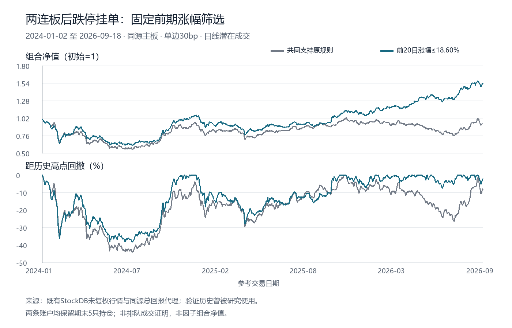

# 两连板急跌策略：回撤归因、固定筛选与事件因子

已完成原始策略归因、三个事前指定风险特征、固定阈值筛选的四条成本路径，以及收盘形成事件因子的真实输入计算。本次官网算力0；保留原已完成账户，不重跑旧止损版或根据验证收益修改参数。

## 原始大回撤的来源

原始五年30bp账户最大回撤34.63%，发生于2023-12-13至2024-07-24。净值147,962.96元降至96,718.77元，损失51,244.19元。五只持仓的净值损失贡献为：000820 16,068.19元（10.86个百分点）、000518 12,006元（8.11个百分点）、000608 10,230元（6.91个百分点）、000639 8,260元（5.58个百分点）、002607 4,680元（3.16个百分点）。贡献加总与账户变化误差小于0.000000001元。

该段只有1笔买入、没有卖出，费用86.19元，仅占损失0.168%；其余主要是持仓价格损失。原规则仅在收益严格超过10%时卖出，长期亏损股票会持续占据五个持仓槽位。完整1211个参考日中943日五个槽位占满；期末五只未平仓的市值相对入场含费支出共少54,090.25元。已平仓交易100%胜率是仅允许止盈的机械结果，不能表示全策略100%成功。

这些股票身份用于事后损失核对，未用来剔除未来股票或挑样本。归因解释了账户为何下跌，但不证明连跌的因果机制。

## 哪个事前因素与后续连跌有关

在读取新标签前固定三个高值风险假说：连板之前20日涨幅、前两板一字板占比、第二板成交金额相对更早20日中位数的放大量。只在2021-09-22至2023-12-29发现段各取一个中位数阈值，不扫描符号、窗口、权重或多档阈值；标签跨越发现段终点的事件剔除。

选中**连板之前20日涨幅**。对挂单日t，它是同源总回报价格`P[t-3]/P[t-23]-1`，要求t−23至t−3的21个独立参考日价格齐备，排除紧接着的两次涨停。发现段阈值为**18.5950413%**。选择依据是发现段低半区较高半区的5日毛收益改善，验证标签在选择冻结登记之后才读取。

发现段254个完整事件的低/高组5日均收益为−3.15%/−5.20%，差2.05个百分点，但月块95%区间含0。金额放大量有相近线索；一字板占比不支持原高风险方向。本次只使用选中的一个筛选，不添加第二项组合。

2024-01-02至2026-09-18的后段有736个完整前瞻事件：

- 连板前涨幅不超过18.60%：364例，跌停挂单价格至第5日收盘均收益−1.00%；未来5日最低价格相对买价跌至−10%以下的比例40.11%；出现连续两个跌停收盘的比例5.49%。
- 超过18.60%：372例，同口径均收益−6.04%；对应两项风险比例68.01%及16.40%。
- 低组减高组平均收益差5.03个百分点，月块95%区间约[2.05,8.01]个百分点；2024/2025/2026分年差异方向相同。原涨幅与毛收益的合并事件Spearman为−0.23649，**不是每日横截面RankIC**。

连续两个跌停指t+1至t+5内任意相邻两日分别收于各自跌停价；入场日仅要求触及跌停，不要求封板。缺失前瞻行情不当作没有连跌。最低价格风险统计不等同可成交止损。

这支持“前期上涨已经较多的连板急跌股票更脆弱”的风险关联，未证明获利盘、游资离场等具体因果。事件重叠、三特征选择及月块区间未做多重比较校正；后段历史曾被其他研究使用，**不是完全未见的样本外数据**。低风险组5日平均毛收益仍为负，不能单凭这项事件统计称为正alpha。

## 固定筛选策略的完整账户比较

在共同的特征已知股票支持上，两条账户均从2024-01-02的10万元独立开始，至2026-09-18，共659日。共同控制保留原规则；筛选账户只增加“连板前20日涨幅≤18.5950413%”。均在前两日涨停后、当日开盘前挂跌停价买单，T+1后价格收益严格超过10%止盈，最多5仓、每笔≤上一日净值20%、100股整手、按代码事前排序、1%当日成交量容量上界。没有新增止损、时间退出或同日卖出现金循环买入。

- **30bp控制**：净−5.52%，年化−2.15%，日收益年化Sharpe0.074，最大回撤44.11%；16买/11卖/期末5仓。
- **30bp筛选**：净+53.64%，年化17.85%，Sharpe0.750，最大回撤38.48%；39买/34卖/期末5仓。
- **50bp控制**：净−6.68%，年化−2.61%，Sharpe0.059，最大回撤44.46%。
- **50bp筛选**：净+48.96%，年化16.46%，Sharpe0.703，最大回撤38.94%。



筛选30bp分年净收益为2024年−4.77%、2025年+10.79%、2026年至9月18日+45.62%。收益优势主要在后期形成，并未消除早期损失：筛选账户2024-07-25一度从初始10万元降至61,515.16元。筛选改善了这条固定历史账户，但仅止盈造成的长期亏损持仓和资金占槽问题仍存在。

筛选30bp已平34笔净盈利76,745.25元，期末5仓未实现账面亏损23,107.72元，两项合计等于净收益53,637.53元，未假设期末退出费。前5笔只占已平盈利22.84%，并非一笔暴利支撑；相比控制的优势主要来自更多止盈闭合及槽位路径变化。这是完整账本分解，不是剔除交易后的反事实检验。该账户最大回撤期费用623.84元仅占损失1.62%，持仓价格缩水仍是主要负担。

不能将此处2024年开始的控制−5.52%直接与原2021年开始账户+24.32%比较；两者初始持仓和资金路径不同。5日事件毛收益也不能当作账户持有到10%止盈的复利净值。这次没有因结果正面而另换阈值或剔除亏损股票。

## 转为真正可计算的稀疏事件因子

实现位于`panda_alpha/limit_event_factor.py`。在t−2、t−1均收于实际涨停、t日确认触及跌停的事件股票上：

```text
F[i,t] = -(P_total_return[i,t-3] / P_total_return[i,t-23] - 1)
```

较低的前期涨幅对应较高分数；非事件和缺项输出NaN，保留完整原始输入索引，不填0、不延长事件、不人为制造10组。18.60%用于账户筛选，因子本身保持连续数值而非把阈值变为另一个排名优化。

当日是否触及跌停只能在当日观察后确定，因此这是**t收盘形成、最早t+1开盘使用**的因子。它不是以t收盘信息选t日跌停挂单，不等价于原日内买入时钟。局部调用：

```python
from panda_alpha.limit_event_factor import LimitEventFactor

# 各字段为(date, symbol)多级索引Series；symbol保留六位代码。
# 显式输入原始未复权价、同日真实价带、同源因子与已知资格。
fields = {
    name: bars.set_index(["date", "symbol"])[name]
    for name in ("raw_close", "raw_high", "raw_low", "up_limit",
                 "down_limit", "amount", "adjustment_factor", "eligible")
}
factor = LimitEventFactor("prior_extension_20")
values = factor.calculate(fields, independent_calendar,
                          adjustment_factor_role="total_return_factor")
coverage = factor.coverage_counts()
```

完整来源实际输出3,840,482个身份键；7,418个盘前两板候选、1,138个触价事件，其中139个所选特征未知，**999个有限因子值**。后段736个完整次日开盘至t+5收盘标签的事件平均价格收益为−1.66%。这与跌停买价标签不同。

固定5日格点、每形成日最少4个有效事件，仅**6个有效IC期**：RankIC均值**0.03972**，Pearson IC均值0.12324，ICIR0.22357。把全部事件合并的Spearman0.19742不能替代6期RankIC，也不能据它证明长期稳定性。此稀疏因子不具备正式10组证据，账户Sharpe超过0.5不自动成为这个因子的入池资格。

6个截面合计36个事件。此处ICIR是Pearson IC均值除以其样本标准差，未年化，不是RankICIR。

官网字典列有`cal_limit_up/cal_limit_down`，但本账号原生字段价格基准、历年ST/IPO例外、实际输入及形成时点尚未认证。本次完成本地因子，不声称已上传、官网持续更新或正式入池。

## 来源修复和复核

持仓真实缺价处分别通过新官方停复牌原件核实600234、605178、002693的确切状态，保留每次原始断点。只续未完成账户；完成的控制、事件标签和因子不重跑。确切停牌日按原持仓会计处理，同源asof因子与上一有效报价因子逐项核对一致；不填交易价、成交量或假定停牌可卖出。002693在2026-05-25撤销ST后，原来源直到6月24日才更正标记，因此仅修5月25日至6月23日持仓执行价带为10%，未放宽原来源买入资格。公告精确盘前公开时点仍未知，不作为预测筛选。

日线潜在成交不证明自己的跌停买单或止盈卖单能够排队成交；1%总成交量也不是跌停价成交容量证明。公司行动按同源总回报等价单位代理，非真实分红送股现金流水。完整历史成员、风险警示、重新上市例外及可用时点没有全部PIT认证。这些限制与高回撤一起阻止直接将本次结果认定为可上线策略。

46项针对性测试通过，覆盖特征窗口、未知值、收盘因子时钟、稀疏索引、T+1和账户断点续算。完整净值与交易账本复算误差低于1e−10；独立只读审阅未发现信号前视或重复记账。公开仅留源码、短指标和图片，行情库及逐股逐日账本未复制发布。

短结果`docs/results/limit-event-factor-20261014.json`；私有协议、URL/SHA、发现/验证分段及恢复点在`research_runs/limit_reversal_optimization_20261014/`。新增6个唯一研究context（3描述、2账户、1事件因子），累计565=415历史+150唯一；不是新增6条alpha。旧夜间自动研究保持暂停。
