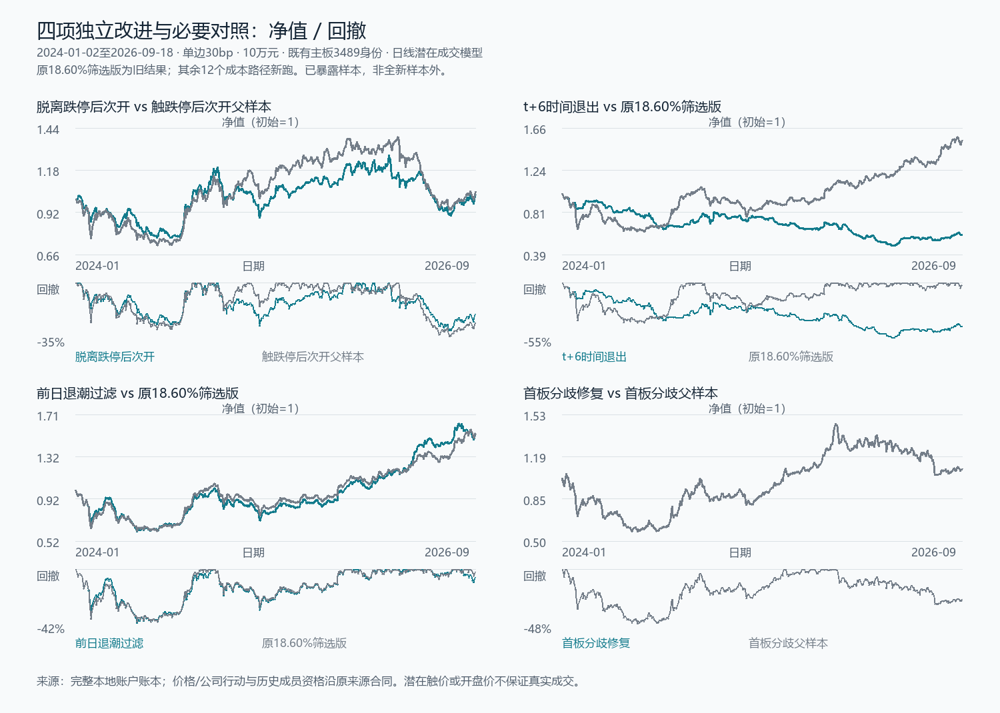

# 连板急跌策略：四项独立改进的完整对照

四项均按用户授权的顺序测试，定义在结果前冻结，没有叠加条件或依据中途收益修改参数。另加两个同样入场时钟的父样本，共6个经济context、12条30/50bp成本路径。旧筛选版只读结果，不重跑。**没有一项在两个成本档同时取得更高净收益、更高Sharpe及更低回撤；本次没有支持“显著改善”的版本。**官网费用0。

## 比较口径

评价2024-01-02至2026-09-18，共659个独立参考交易日，既有主板3489个身份；沿用此前来源及公司行动总回报等价单位。初始10万元、最多5仓、每笔不超过前收盘净值20%、100股整手、代码事前排序、同日卖出现金不循环用于新买入，成交量上界为当日总股数1%。每边30bp或50bp为费用和滑点统一代理。T+1后经济价格收益严格超过10%仍止盈，没有复活旧8%止损；期末保留实际账面仓位，不假设强制清仓。

该窗口已经用于前面的研究，**不是新的未暴露样本外**。日线触价或开盘报价不保证限价队列、开盘集合竞价或真实可成交规模；等价单位也不证明实际分红现金及公司行动后股数。新开盘模式遇开盘涨停就阻止买入，即使后来打开涨停也不追认开盘成交。

前三项保留连板前20日经济涨幅≤18.5950413%的旧筛选，末两板不计入这20日。第四项按用户确认不使用该阈值。

## 四项固定规则与完整结果

以下Sharpe均由659日完整净收益计算；累计净收益和最大回撤单位为百分比。

**旧无止损筛选版**：30bp累计+53.64%、年化17.85%、Sharpe0.750、最大回撤38.48%；50bp为+48.96%、年化16.46%、Sharpe0.703、回撤38.94%。39次买入、34次止盈，末5仓。该已完成对照保持不变。

**1．跌停日收盘脱离跌停，下一参考日开盘买入。**前两日涨停，原筛选通过，当日合法日线最低价触跌停，但收盘高于跌停，收盘确认后次开尝试买入。为分开入场时间与恢复条件，父样本也是触跌停后次开买入，只不要求收盘脱离跌停。

- 目标30bp：累计**+2.89%**、年化1.09%、Sharpe**0.167**、回撤**29.47%**；50bp：**+1.13%**、年化0.43%、Sharpe0.140、回撤29.46%。28次买入、23次止盈，末5仓。
- 同钟父样本30bp：+4.87%、Sharpe0.200、回撤32.76%；50bp：+2.68%、Sharpe0.169、回撤32.84%。31买、26止盈，末5仓。

收盘恢复条件在本窗口降低了回撤，也降低了收益和Sharpe；与原跌停买价版本相比，收益差距更大。次日开盘价格与入场机会发生了变化，不能把全部差距归因于一个选股字段。两成本的配对收益区间均跨零，不支持收益升级。

**2．固定时间退出。**保留原跌停价买入，允许t+1至t+5持有；仍未止盈时，t+6开盘尝试退出。t为实际买入日；停牌不压缩参考日，卖出阻断后保留待退出状态。不增加百分比止损。

- 30bp：累计**−41.72%**、年化−18.66%、Sharpe**−0.844**、回撤**52.66%**。
- 50bp：累计**−48.29%**、年化−22.29%、Sharpe**−1.073**、回撤**56.86%**。

222次买入、82次止盈、138次时间退出，末2仓。30bp累计费用17,772.13元，按初始资金计17.77个百分点；账面价格盈亏贡献约−23.95个百分点，合计净亏41.72%。这不是另跑的零费用反事实：交易规模和仓位也受费用影响。固定退出释放槽位，截断部分等待较久的仓位，并进入更多新交易；它没有把这批急跌事件变成正期望短线交易。相比旧39次买入，换手和费用显著增加。该确切t+6版本没有升级价值。

**3．前一日市场退潮过滤。**仍按原跌停买入，只在前一参考日同源、已知合格且正常交易的股票中，跌停收盘数量不超过涨停收盘数量时开新仓。未知状态、价格或股数不填成“未涨跌停”；没有有效群体则不开仓。它是原3489身份来源的已知群体统计，不声称全A或完整历史成员覆盖。

- 30bp：累计**+52.96%**、年化17.65%、Sharpe**0.750**、回撤**39.52%**。
- 50bp：累计**+48.45%**、年化16.31%、Sharpe**0.705**、回撤**40.05%**。

38买、33次止盈，末5仓。相对旧基准，累计收益略降，回撤约增加1个百分点，Sharpe仅微小变化。评价段固定候选从2990减至2855，不能把135个被拒绝候选当作135笔实际交易。净买入次数仅少1也不等于只改1笔：旧9个买入身份被移除、新8个加入；连同退出，旧17个动作消失、新15个动作出现，56个动作身份共享。共享动作的数量和费用也会随现金/槽位改变。这是完整策略路径的比较。配对收益区间跨零，未支持有意义的收益或风险改善。

**4．首板分歧修复。**b日前20个完整交易参考日没有涨停收盘；b日首次涨停；b+1日未继续涨停，收盘经济价高于b−1日，最低价没有触跌停；b+2开盘尝试买入。首板前20日、板日和回调日都要求合法价格、明确交易状态及正成交股数。父样本同为首板后未继续涨停再下一日开盘，只不加“经济收盘高于首板前/未触跌停”两项；父目标共同要求可比复权角色。

- 30bp：累计**+9.36%**、年化3.48%、Sharpe**0.266**、回撤**45.52%**。
- 50bp：累计**+6.84%**、年化2.56%、Sharpe**0.238**、回撤**45.67%**。

父样本和修复目标的两成本完整净值相同：都是28买、23止盈、末5仓。评价段6511个父候选，修复条件只排除159个，保留6352个；剔除约2.44%。这些差异没有改变当前固定槽位、代码优先和退出约束下的实际成交。**条件变了，不等于实际持仓变了，也不等于提供了新的有效alpha。**它没有解决长期套牢及占用仓位的问题。

## 如何判断“显著”

事前固定配对比较：恢复条件对同钟父样本、时间退出和市场过滤对旧筛选版、首板修复对首板父样本。完整同日净值严格对齐，不按可用日期取交集；初始现金都是10万元。

以候选减对照的日净收益均值×252为统计量，固定seed20261014，33个日历月整体配对重采样2000次；重复月按实际日数加权，取95%区间。这是**年化算术收益差区间，不是累计收益、CAGR或Sharpe区间**。

- 恢复筛选30bp年化算术差约−1.08个百分点，区间[−16.71，+15.86]；50bp约−0.93，区间[−16.52，+15.95]。
- 时间退出30bp约−38.30，区间[−72.45，−4.79]；50bp约−41.79，区间[−75.59，−8.19]。此固定方法下方向为负，也与收益、回撤恶化一致。
- 市场过滤30bp约−0.28，区间[−10.19，+9.93]；50bp约−0.26，区间[−10.17，+9.96]。
- 首板修复与父样本的已实现完整账户路径完全一致，配对差和区间均为0。

月块没有覆盖所有跨月依赖，样本已经暴露，多项比较未作多重检验校正；跨零不是等价证明，负区间也不是普遍未来规律。本次没有据此再调整窗口、阈值、符号或组合条件。

## 执行与来源修复

初始实现复核发现下一开盘候选提前依赖入场日的交易可用性。原进程在完成来源读取/形成信号/账户结果前停止，保留旧冻结代码及协议。修复后，昨日形成候选先预留槽位和现金，执行日再检查可交易性，不把跳过低代码股票后的槽位自动让给高代码。首板父目标同时要求正成交量与已知同源经济价格角色；市场过滤只对旧固定候选增加前日群体条件。80项合成测试通过；修复0新增经济context。

初轮4条完整、8条在三个持仓状态缺口暂停。只审阅实际断点的公司原件，并核同源逐日asof因子与前一合法报价一致：

- [600370公告](https://static.cninfo.com.cn/finalpage/2026-04-29/1225233408.PDF)：4月29日全天停牌，4月30日复牌并实施风险警示，当时5%。
- [002686停牌公告](https://disc.static.szse.cn/download/disc/disk03/finalpage/2026-03-31/d4629e20-d4f4-4b12-b03d-dfaa6868342f.PDF)及[后续复牌公告](https://static.cninfo.com.cn/finalpage/2026-04-04/1225080358.PDF)：3月31日至4月3日四个参考日停牌，原4月2日计划未实现，实际4月7日开市复牌；未指令价带变更。
- [600537停牌公告](https://static.cninfo.com.cn/finalpage/2026-04-28/1225208200.PDF)及[复牌公告](https://static.cninfo.com.cn/finalpage/2026-04-29/1225228133.PDF)：4月28日全天停牌，4月29日开市复牌并实施*ST、5%。

八条后缀续算后仅剩父样本两条在下一日601718缺状态；[公司公告](https://static.cninfo.com.cn/finalpage/2026-04-30/1225263279.PDF)明确4月30日全天停牌、5月6日开市复牌并实施ST、5%。只续最后两条后缀；十条完整路径不重跑。

三个警示股票的来源ST标记滞后至6月24日，限定既有持仓执行价带桥接至6月23日，之后回到已冻结动态规则。没有修改原始报价、股数、预测资格或冻结掩码。旧及新有界限价修复与预测候选范围加两参考日的交集核查为空。公告精确盘前公开时间仍未知，因此这些状态修复不作为预测特征或公告PIT证明；没有把缺价、退市风险或停牌解释成现金兑付。

## 结论与保存

本轮完成用户指定的全部四个方向及必要对照。恢复条件体现较低历史回撤但收益很弱；固定时间退出恶化；市场过滤没有明显增益；首板修复没有改变实际交易。**原筛选版仍保持较高历史收益，但38%左右回撤、日线潜在成交和来源PIT限制没有消失。**前一轮t+1触跌停退出是降低历史回撤的取舍，不能自动与本轮条件叠加。

十二条独立账户复核全部通过：659完整日期、现金与净值恒等、逐笔费用和已平净盈亏、末仓等价单位及未实现盈亏、日净收益和指标复算一致；时间退出没有早于t+6，未混入其他止损。卖出阻断可从持久化退出单核对，买入阻断只引用运行summary，没有冒称从完整买单重建。对账通过认证的是内部会计一致性，不是成交队列或PIT。

本轮是交易策略对照，没有重算原事件因子或宣称新的RankIC/正式入池候选。6个新增唯一context包含必要父对照，累计574=415历史+159唯一；来源、软件及费用修复均0新增。官网费用0，旧夜间自动研究保持暂停。

实现：`panda_alpha/limit_entry_signals.py`、`panda_alpha/limit_reversal.py`及`panda_alpha/limit_paired_comparison.py`。固定运行及有界续接分别在`scripts/research_limit_next_directions.py`、`scripts/resume_limit_next_directions.py`、`scripts/resume_limit_next_parent.py`；`scripts/summarize_limit_next_directions.py`只读完整结果。短结果在`docs/results/limit-next-directions-20261014.json`，精确协议、输入SHA、公告URL、账号恢复点与复核在私有`research_runs/limit_next_directions_20261014/`。不公开复制行情、报告全文或逐股逐日账。
