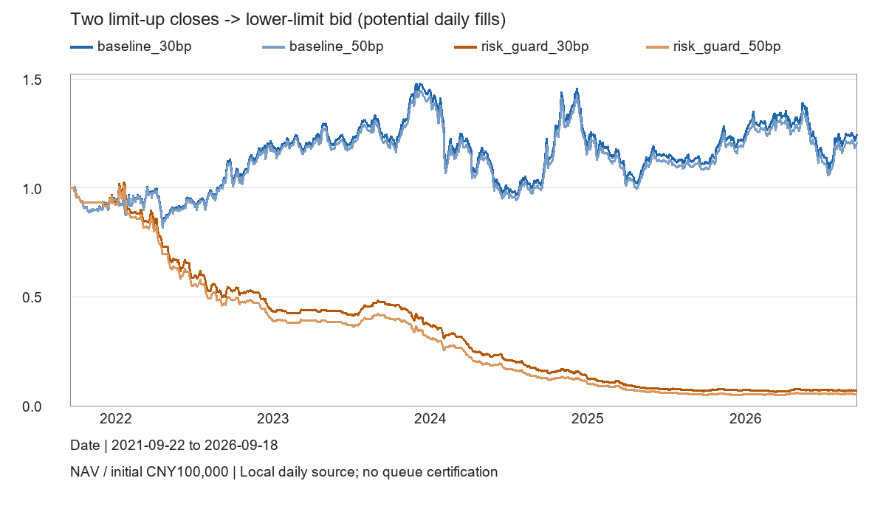

# 两连板后跌停限价买入策略

## 事前固定规则

在此前两个独立交易日均收于涨停价后，于下一交易日开盘前挂该日跌停价买单。第三日只要触及跌停即可触发潜在成交，不要求它最终跌停收盘。连续三板及以上后发生该事件也符合条件。这是连板急跌反转假说，与通常首板追涨的入场方式不同。

原始版在价格收益严格超过10%时止盈。风险版保持同一入场条件，增加8%止损和最多10个参考交易日持仓（买入日计第1日）。遵守T+1；同日触及止盈和止损时，风险版保守按止损处理；低开越过止损按更差开盘价；一字跌停不假定卖得出。期末保留未退出持仓，不强行清仓。

初始资金10万元，最多5个持仓，单笔不超过上一日净值20%，100股整手买入。多个信号按代码顺序事前选择，不利用当日未来成交量或收益挑股票。不利用当日晚些时候卖出所得资金扩大开盘前买单。整个请求超过当日总成交股数1%时阻止成交，不凭日线推断部分成交。该约束是事后成交容量上界，不能证明跌停价格处有足够对手量。

## 数据和执行边界

既有主板身份3489只，独立参考交易日2021-09-22至2026-09-18。非全历史上市成员认证；保留摘牌身份，不仅选择当前存活股票。买入排除来源当日ST标记和上市前20参考交易日。原始未复权行情与同日参考前收盘价计算涨跌停，价格按分四舍五入；缺失规则、状态、价格不填零。主板ST变化按2026-07-06实施日期处理。特殊重新上市等完整例外库存未知。

公司行动使用同来源累计复权因子的总回报等价单位代理。挂单和原始买入数量使用真实原始价格与整手；后续等价单位不是实际送股股数及现金红利流水。日线触及买价或卖价只代表潜在成交，没有盘口排队、集合竞价和限价成交量证明。

30bp与50bp为每一边的费用和滑点合并代理，并非历史逐笔券商佣金及印花税重建。该窗口既有数据曾用于研究，不属于全新未见样本。两套策略事前登记，费用档位不增加策略定义，不扫描参数。

## 结果

四条固定路径已完成，官网算力使用0。

- 原始版30bp：累计+24.32%，年化4.63%，日收益年化Sharpe0.318，最大回撤34.63%；35次买入、30次止盈、期末5只持仓。
- 原始版50bp：累计+20.85%，年化4.02%，Sharpe0.291，最大回撤34.74%。
- 风险版30bp：累计−93.07%，年化−42.61%，Sharpe−2.572，最大回撤93.92%；499次买入、498次卖出、期末1只持仓。
- 风险版50bp：累计−94.69%，年化−45.71%，Sharpe−2.899，最大回撤95.17%。

## 结果解释

原始版已完成卖单全盈利，是只允许止盈的机械结果。五只未卖出股票仍按市价计入净值，没有删除亏损持仓。002607从2021-10-15持有到期末，000639从2022-03-24持有到期末；已完成交易最长也持有798个参考交易日。不能用已平仓100%胜率判断策略优劣。

风险版30bp有320次止损、163次止盈、15次持有期退出，已完成交易胜率33.33%，持有期中位数2天。释放资金后反复买入同类急跌事件，在本窗口表现更差；不能仅凭此把全部损失归因于止损，也不能把加止损默认称为成功优化。本次结果不支持直接实盘。

下一条更有意义的预先固定假说是等待跌停打开及承接再入场，而非不断调止盈、止损百分比。这会改变已确认入场方式，应另登记比较。本次没有据结果扫描新条件。

## 来源断点和续算

000518原始ST标记未更新，导致原始版2026-05-20停止。[公司临-2026-23公告](https://static.cninfo.com.cn/finalpage/2026-05-19/1225313933.PDF)两页已完整审阅，明确5月19日停牌、5月20日撤销警示并恢复10%价格限制。仅修既有持仓执行价格带，未改行情或放开旧来源ST买入排除，未声称完整ST历史认证。保留原断点，两条未完成账户按原交易日索引继续87日；已完成风险版不重跑。20项合成测试通过，包含断点续算和完整路径账户相等。

## 有界分钟核查

事前选择2025年起原始30bp最早买单，断点前仅有2例可核。000720于2026-03-30 09:47触及4.96元，000586于2026-04-10 09:34触及22.61元，均有随后原价成交分钟。收到241及239条分钟记录；后者不是完整每分钟覆盖认证。它们仍不能证明自己的挂单排队成交，也不是五年分钟回测。

## 实现和保存

策略`panda_alpha/limit_reversal.py`，本地回测`scripts/backtest_limit_reversal.py`，限定续算`scripts/resume_limit_reversal.py`，测试`tests/test_limit_reversal.py`。完整协议、来源/修复哈希、原断点和组合净值、30bp买卖账本在私有`research_runs/limit_reversal_20261014/`；公开只留源码、短结果和净值图。2套策略新增2个唯一context；来源、成本修复0新增。旧夜间自动研究保持暂停。

