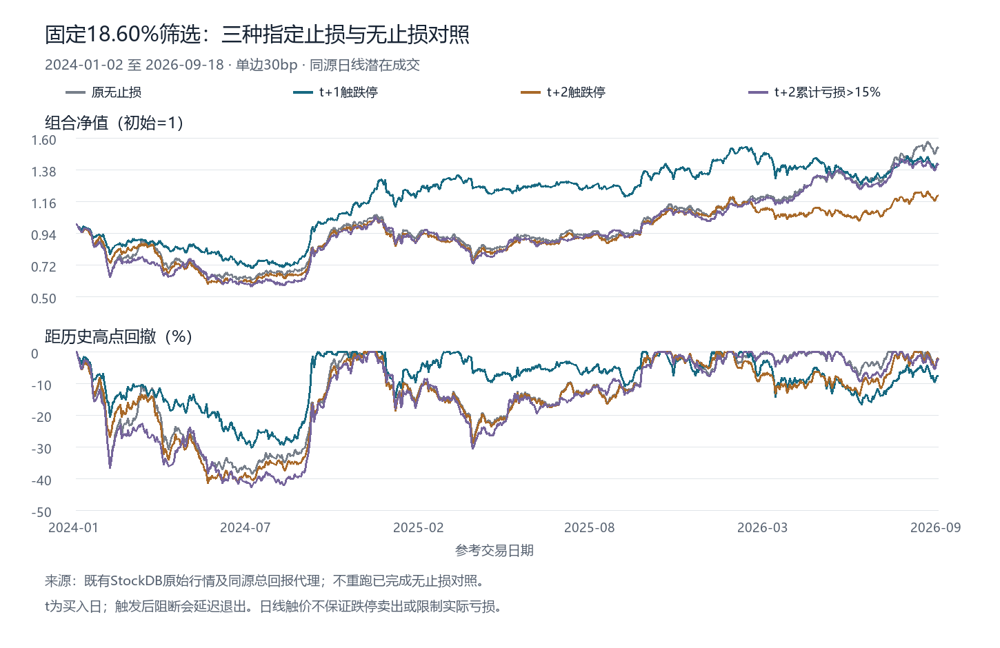

# 固定筛选策略的三种指定止损

用户明确要求测试t+2跌停、t+1跌停、t+1与t+2累计亏损超过15%三种规则，并确认加在当前18.5950413%前期涨幅筛选版。三种退出定义均在首个新账户结果前冻结登记；单边30bp、50bp各一条，六条路径已完整。官网费用0，不重跑旧无止损、因子、发现段或已完成成本路径。

## 保持一致的部分

股票范围、原始行情和复权代理与[上一研究](limit-event-factor-20261014.md)相同：既有主板3489个身份，独立参考日，评价2024-01-02至2026-09-18，共659日，初始10万元。前两日收于实际涨停，开盘前挂当日跌停买单；连板之前20日涨幅≤18.5950413%，末两板不计入这20日。最多5仓、每笔≤上一日净值20%、100股整手、按代码排序、不循环利用同日卖出现金，1%当日总成交股数容量上界。T+1后经济价格收益严格超过10%仍止盈。

t是实际买入日；t+1和t+2是其后的第一、第二个独立参考交易日，不把买入日计为第一日，也不因停牌压缩时间。

## 三条独立规则

**t+1触跌停**：仅在t+1日最低价触及当天实际跌停价时，尝试按该跌停价卖出。若同根日线同时触及止盈和跌停，无法确定顺序，事前保守按跌停退出优先，另记录时序不确定。明确停牌没有触价事件，不把检测顺延到下一交易日。

**t+2触跌停**：与上一条同样执行，仅把指定检测日固定为t+2；不同时附加t+1规则。

**t+2累计亏损超过15%**：仅检查t+2盘中止盈之后仍持有的仓位。当日末经济价格相对原买入经济价格严格低于85%时确认，最早在t+3开盘尝试退出。费用不计入触发阈值；累计使用价格比率，不把每日百分比简单相加。正好亏15%不触发，用原金额小数的Decimal严格比较。若t+2明确停牌，沿既有合法持仓估值检查并标注为停牌估值代理，不称收到真实成交收盘；因子变化与估值角色不明仍保持source-pending。

三条规则触发后，一字跌停、明确停牌或日总量不足都阻止卖出，并持续保留待退出状态，后续可执行日开盘重试。**触发线不等于亏损硬上限。**没有在指定日触发时，仍按原10%止盈规则继续持有，没有新加长期止损或最长持有期。旧8%/10日风险版未复活。

## 完整结果

所有结果为潜在日线成交模型的净值，费用和滑点为每边统一代理；年化Sharpe按完整日净收益计算。

- 无止损原筛选，30bp：累计**+53.64%**，年化17.85%，Sharpe**0.750**，最大回撤**38.48%**；39买/34卖/末5仓。50bp：+48.96%，Sharpe0.703，回撤38.94%。这是旧已完成对照，直接收取结果。
- **t+1触跌停，30bp**：累计**+41.76%**，年化14.28%，Sharpe**0.666**，最大回撤**30.24%**。50bp：**+32.99%**，年化11.52%，Sharpe0.565，回撤31.57%。85买、51次止盈、29次指定止损、末5仓。
- **t+2触跌停，30bp**：累计**+20.30%**，年化7.32%，Sharpe**0.402**，最大回撤**41.61%**。50bp：**+17.00%**，年化6.19%，Sharpe0.361，回撤41.77%。34买、26次止盈、3次指定止损、末5仓。
- **t+2累计亏损>15%，30bp**：累计**+41.96%**，年化14.34%，Sharpe**0.618**，最大回撤**43.00%**。50bp：**+37.55%**，年化12.97%，Sharpe0.575，回撤43.35%。42买、35次止盈、2次指定止损、末5仓。

## 执行与风险解释

t+1规则在30bp下将最大回撤降低8.25个百分点，但累计收益减少11.88个百分点，Sharpe也下降。交易从39次买入增加至85次，完整费用从原5,013.65元增加至11,221.63元；50bp时费用18,019.75元，成本敏感性更明显。它改变了退出和资金槽位路径，不能把整个收益差简单归因于费用。

t+1规则触发29次，全数在潜在模型中退出。一次一字跌停阻断后延迟1个参考日才退出；最差止损毛经济收益为−19.05%。还有3次同日止盈/止损双触价，不知道真实先后，按已冻结保守顺序处理。止损原因是指定日触跌停，某些触发时相对原买价可能仍有盈利，不等于每次都有固定10%亏损。

t+2触跌停只触发3次，其中一次一字跌停导致退出延迟1日；最差毛收益−19.14%。t+2累计15%规则只触发2次，均在下一参考日开盘退出，最差毛收益**−24.69%**。这直接说明收盘确认到次日执行的跳空风险：15%阈值没有将实际损失锁在15%。本次累计型没有停牌估值触发，两次均来自实际收盘。

三种规则期末仍有5仓，30bp未实现账面亏损分别约29,624.91、25,362.33、27,326.16元，未假设期末退出费用。后两种只检查一个早期时点，无法处理数周、数月后才发生的缓慢亏损；本次结果不支持把它们作为降低回撤的升级。

**若目标是压低回撤，本次三项中仅t+1规则体现出值得保留的历史风险改善；若目标是最大净收益或Sharpe，原无止损仍更高。**t+1的30bp分年净收益为2024年+19.96%、2025年+14.21%、2026年至9月18日+3.46%；年度路径改变不等于已经证明未来稳定。没有据三项结果再改窗口、阈值、符号或增加组合规则。

这只改变配套交易策略退出，原事件因子评分、收盘形成时钟、999个有限值及仅6个有效IC期的证据均未改变，不宣称新的正式入池因子。

## 来源断点、复核与保存

复用上一研究已完成600234、605178、002693的精确持仓状态与有界执行价带修复，原预测筛选资格不变。累计型两档在002868:2025-04-22缺状态时停止，保留原断点。新官方相邻原件确认4月22至25日控制权筹划停牌、4月28日实际复牌，4月29日因风险警示再停牌、4月30日*ST/5%复牌。逐日核同源asof因子与前一合法报价因子一致后，只续两条未完成账户，四条已完成路径不重跑。原件精确盘前公开时点未知，只作已发生持仓状态修复，不作预测特征。

36项策略合成测试通过，其中14项为新止损测试，覆盖严格15%边界、T+1、停牌/一字跌停/容量重试、止盈后不追记收盘止损及checkpoint续接。六条完整净值/费用/已平与未平盈亏对账误差小于1e−7元。日线触价、原始限价队列、完整历史成员/风险警示及公司行动现金股数流水仍未全部认证，原有成交和PIT边界保留。

实现`panda_alpha/limit_reversal.py`；固定运行`scripts/research_limit_stoploss.py`；限定续接`scripts/resume_limit_stoploss.py`；完成结果复核`scripts/summarize_limit_stoploss.py`。短结果`docs/results/limit-stoploss-20261014.json`；协议、来源URL/SHA、交易净值及恢复点在私有`research_runs/limit_stoploss_20261014/`，不公开复制行情、全文PDF或逐股逐日数据。

新增3个唯一退出context，费用与来源修复0新增；累计568=415历史+153唯一。官网消耗0，旧夜间自动研究保持暂停。
